# Final Project Experimental Results

**Project:** Evidence-aware pre-payment risk assessment for UPI-style payments  
**Final representation:** V2 (47 features) — the only representation reported here  
**Nature of the evaluation:** synthetic. No real UPI, bank, PSP or NPCI data were used; no result below is a measurement of real-world performance.  
**Code evaluated:** snapshot of git HEAD `9022a9feb65effa32779207e32458c0d37e9bb61` (working tree with uncommitted changes; exact file hashes in `reproducibility/`).

All numbers in this report are generated from the result files under `results/final_v2/` (and, for the replay, `results/graph_replay/`) by `scripts/final_v2/make_final_report.py`. Figures are in `results/final_v2/figures/` (PNG, 300 dpi, and SVG); tables in `results/final_v2/tables/` (Markdown and CSV); the main tables are also rendered as images in `results/final_v2/table_images/`.

### Result categories used throughout

| Label | Meaning |
|---|---|
| **Existing reported seed-42 result** | Values in `models/metrics_v2.json` / `evaluation_v2/metrics.json` produced when V2 was frozen |
| **Reproduced result** | The same frozen artefact re-evaluated now on the regenerated seed-42 corpus |
| **Multi-seed result** | Newly generated corpora for seeds 42–51, V2 refitted per seed with the identical protocol |
| **End-to-end / replay result** | The ten-family assessment evaluated on chronological replay streams (seeds 42–44) |
| **Software test result** | Implementation correctness (pytest); not a predictive metric |

## 1. Project Experimental Configuration

- **Classifier:** `HistGradientBoostingClassifier` wrapped in isotonic calibration (isotonic, 5-fold); HistGradientBoosting with max_iter 300, learning_rate 0.08, max_leaf_nodes 31, class_weight balanced, random_state = seed. No resampling (no SMOTE).
- **Representation:** V2, 47 features in 9 implementation groups; the live system organises evidence into ten families (Section 3).
- **Split:** stratified; 25% test, then 20% of the remainder as validation (72,000 / 18,000 / 30,000), random_state = seed.
- **Threshold rule:** highest validation recall with validation FPR ≤ 1%, stored to 4 d.p. Frozen seed-42 threshold: **0.1123** (full precision 0.1122651). The test split is used once, after the threshold is fixed.
- **Primary metrics:** PR-AUC (average precision) because fraud is ~1.2% of payments; ROC-AUC, recall at ~1% FPR, precision, F1, MCC, Brier score and calibration are also reported.
- **End-to-end system:** ten evidence families aggregated by the production rule (damped maximum + fact-aware corroboration → risk R; availability → coverage C; verdict bands APPROVE < 22 ≤ WARN < 45 ≤ STEP_UP < 70 ≤ BLOCK plus hard-block findings). The Classifier family uses the frozen V2 model (Section 15).

### 1.1 Verification of the existing seed-42 result

The frozen V2 artefact (`models/risk_model_v2.pkl`) was re-evaluated on the regenerated seed-42 corpus (dataset fingerprint identical to the frozen one) with the original split function (`scripts/train_model_v2.splits`).

| Metric | Existing reported | Reproduced now |
|---|---|---|
| pr_auc_average_precision | 0.732600 | 0.732600 |
| roc_auc | 0.989974 | 0.989974 |
| recall | 0.780282 | 0.780282 |
| precision | 0.484266 | 0.484266 |
| f1 | 0.597627 | 0.597627 |
| fpr | 0.009951 | 0.009951 |
| brier | 0.005554 | 0.005554 |
| brier_skill_score | 0.525069 | 0.525069 |
| Confusion (TN / FP / FN / TP) | 29,350 / 295 / 78 / 277 | 29,350 / 295 / 78 / 277 |

- Maximum absolute metric difference: **0.0**; per-row predicted probabilities differ from the stored test predictions by at most 1.1e-16. **The existing seed-42 test result is reproduced exactly.**
- The threshold re-derived from the validation split alone is 0.1122651 → 0.1123 (matches the stored value: True).
- **Discrepancy found and explained (validation only):** `models/metrics_v2.json` reports validation TP = 159 (recall 0.7465) because it was computed at the full-precision threshold. At the stored threshold 0.1123, which is the one the service applies and the one behind the reported test result, validation TP = 158 (recall 0.7418). Exactly 1 validation fraud row and 1 test legitimate row lie between the two values; at the full-precision threshold the test result would be FP = 296 instead of 295. The existing test values are therefore kept unchanged; the validation column of Table 4 uses the stored threshold.

## 2. Dataset Statistics

**What was measured:** the seed-42 V2 corpus used by the frozen model. **Configuration:** 120,000 payments, nominal fraud rate 0.012, 2,000 payers, seed 42.

### Table 1 — Dataset and split statistics (V2 corpus, seed 42)

| Split      |   Total |   Legitimate |   Fraud |   Fraud % |
|:-----------|--------:|-------------:|--------:|----------:|
| All        |  120000 |       118581 |    1419 |    1.1825 |
| Train      |   72000 |        71149 |     851 |    1.1819 |
| Validation |   18000 |        17787 |     213 |    1.1833 |
| Test       |   30000 |        29645 |     355 |    1.1833 |

Simulated payers: 2,000 distinct payers realised (generator setting 2,000; counted by instrumenting the generator, whose output was checked to be identical to the cached V2 frame — the V2 frame stores no payer identifier). Synthetic data.

Payee history is hidden (observation mask) on 29,376 rows (24.48%); fraud prevalence is 1.729% among hidden-history rows and 1.005% among visible ones (a property of the masking rule, which ties visibility to payer count). A message accompanies 54.83% of payments, a purpose is stated on 42.11%, and graph evidence is available on 75.52%.

### Table 2 — Fraud scenario composition (synthetic scenario categories)

| Scenario           | Generator share   |   Realised count (all) | Realised share (all fraud)   |   Test count | Test share   |
|:-------------------|:------------------|-----------------------:|:-----------------------------|-------------:|:-------------|
| Social engineering | 50%               |                    734 | 51.73%                       |          182 | 51.27%       |
| Mule collection    | 22%               |                    278 | 19.59%                       |           80 | 22.54%       |
| Account takeover   | 20%               |                    296 | 20.86%                       |           73 | 20.56%       |
| Card testing       | 8%                |                    111 | 7.82%                        |           20 | 5.63%        |

Generator shares are simulator settings (backend/ml/dataset.SCENARIO_MIX), not estimates of real UPI fraud prevalence.

**Does NOT demonstrate:** these scenario shares are simulator settings; they are not estimates of the composition of real UPI fraud.

## 3. V2 Feature Representation

The 47 features were read from the implementation (`backend/ml/dataset_v2.FEATURES_V2`, identical to the frozen model's feature list). Each is mapped to the live evidence family that reads the same observation (`scripts/final_v2/families.py`). The tenth family, **Classifier**, is model-derived evidence: the V2 model itself, whose inputs are all 47 columns. Three mappings differ from the implementation's own group names and are stated explicitly: `amount_over_user_avg` (group *amount*) → Payer behaviour; `payee_is_phone_address` (group *payee*) → Address and QR; `payee_is_new` (group *relationship*) → Relationship.

| Evidence family | Features |
|---|---|
| Message pressure | 18 |
| Graph | 7 |
| Payer behaviour | 6 |
| Relationship | 4 |
| Payee history | 4 |
| Stated intent | 3 |
| Link safety | 3 |
| Address and QR | 1 |
| Amount context | 1 |
| Classifier (model-derived) | uses all 47 |

### Table 3 — V2 feature inventory (47 features)

|   # | Feature                           | Evidence family   | V2 group (code)   | Type    | Evidence kind             | Missing possible   |   Missing % (seed 42) | Pre-payment   | Meaning                                                                                                                        |
|----:|:----------------------------------|:------------------|:------------------|:--------|:--------------------------|:-------------------|----------------------:|:--------------|:-------------------------------------------------------------------------------------------------------------------------------|
|   1 | amount                            | Amount context    | amount            | numeric | contextual (payment)      | no                 |                  0    | yes           | Payment amount (Rs).                                                                                                           |
|   2 | amount_over_user_avg              | Payer behaviour   | amount            | numeric | payer-side                | no                 |                  0    | yes           | Amount divided by the payer's median prior payment.                                                                            |
|   3 | is_night                          | Payer behaviour   | payer             | binary  | payer-side                | no                 |                  0    | yes           | 1 if the hour is < 6 or >= 22 (IST).                                                                                           |
|   4 | hours_from_usual                  | Payer behaviour   | payer             | numeric | payer-side                | no                 |                  0    | yes           | Circular distance (h) from the payer's most active hour; 0 when the usual hour is unknown.                                     |
|   5 | seconds_since_last_txn            | Payer behaviour   | velocity          | numeric | payer-side                | no                 |                  0    | yes           | Seconds since the payer's previous payment, capped at one day.                                                                 |
|   6 | txns_last_hour                    | Payer behaviour   | velocity          | numeric | payer-side                | no                 |                  0    | yes           | Payer's payments in the preceding hour.                                                                                        |
|   7 | txns_today_over_avg               | Payer behaviour   | velocity          | numeric | payer-side                | no                 |                  0    | yes           | Payer's payments today divided by their daily average.                                                                         |
|   8 | payee_is_new                      | Relationship      | relationship      | binary  | relational                | no                 |                  0    | yes           | 1 if this payer has not paid this payee before (payer-relative novelty).                                                       |
|   9 | payee_age_days                    | Payee history     | payee             | numeric | payee-side                | yes                |                 24.48 | yes           | Days since the payee was first observed in the store.                                                                          |
|  10 | payee_distinct_payers             | Payee history     | payee             | numeric | payee-side                | yes                |                 24.48 | yes           | Distinct payers observed paying the payee.                                                                                     |
|  11 | payee_repeat_ratio                | Payee history     | payee             | numeric | payee-side                | yes                |                 25.12 | yes           | Share of the payee's payers who paid more than once (missing below 5 payers).                                                  |
|  12 | payee_history_available           | Payee history     | payee             | binary  | payee-side                | no                 |                  0    | yes           | 1 if the payee has observed history, 0 otherwise.                                                                              |
|  13 | prior_payments_to_payee           | Relationship      | relationship      | numeric | relational                | no                 |                  0    | yes           | Count of payments this payer has already made to this payee, before T.                                                         |
|  14 | days_since_first_payment_to_payee | Relationship      | relationship      | numeric | relational                | yes                |                 24.4  | yes           | Days since this payer first paid this payee. NaN when there is no prior payment.                                               |
|  15 | relationship_available            | Relationship      | relationship      | binary  | relational                | no                 |                  0    | yes           | 1.0 always: the payer's own ledger is always readable.                                                                         |
|  16 | arrival_span_days                 | Graph             | graph             | numeric | graph                     | yes                |                 24.48 | yes           | Days between the first and most recent NEW payer arriving at this payee.                                                       |
|  17 | lifespan_days                     | Graph             | graph             | numeric | graph                     | yes                |                 24.48 | yes           | Days between the payee's first and last observed activity.                                                                     |
|  18 | payments_per_day                  | Graph             | graph             | numeric | graph                     | yes                |                 24.48 | yes           | Observed payments divided by observed lifespan.                                                                                |
|  19 | component_size                    | Graph             | graph             | numeric | graph                     | yes                |                 24.48 | yes           | Size of the connected component this payee sits in (persisted union-find).                                                     |
|  20 | shared_payer_peak                 | Graph             | graph             | numeric | graph                     | yes                |                 24.48 | yes           | Largest number of payers this payee shares with any single other payee.                                                        |
|  21 | overlap_ratio                     | Graph             | graph             | numeric | graph                     | yes                |                 28.63 | yes           | shared_payer_peak divided by the smaller of the two payer counts. NaN unless BOTH payees have >= 10 payers.                    |
|  22 | graph_available                   | Graph             | graph             | binary  | graph                     | no                 |                  0    | yes           | 1.0 when a graph row exists for this payee, else 0.0.                                                                          |
|  23 | msg_authority                     | Message pressure  | message           | binary  | text                      | yes                |                 45.17 | yes           | 1 if the coercion cue 'authority' fired in the message (coercion.extract_features); missing when there is no message.          |
|  24 | msg_urgency                       | Message pressure  | message           | binary  | text                      | yes                |                 45.17 | yes           | 1 if the coercion cue 'urgency' fired in the message (coercion.extract_features); missing when there is no message.            |
|  25 | msg_fear                          | Message pressure  | message           | binary  | text                      | yes                |                 45.17 | yes           | 1 if the coercion cue 'fear' fired in the message (coercion.extract_features); missing when there is no message.               |
|  26 | msg_pay_request                   | Message pressure  | message           | binary  | text                      | yes                |                 45.17 | yes           | 1 if the coercion cue 'pay_request' fired in the message (coercion.extract_features); missing when there is no message.        |
|  27 | msg_credential_request            | Message pressure  | message           | binary  | text                      | yes                |                 45.17 | yes           | 1 if the coercion cue 'credential_request' fired in the message (coercion.extract_features); missing when there is no message. |
|  28 | msg_secrecy                       | Message pressure  | message           | binary  | text                      | yes                |                 45.17 | yes           | 1 if the coercion cue 'secrecy' fired in the message (coercion.extract_features); missing when there is no message.            |
|  29 | msg_remote_control                | Message pressure  | message           | binary  | text                      | yes                |                 45.17 | yes           | 1 if the coercion cue 'remote_control' fired in the message (coercion.extract_features); missing when there is no message.     |
|  30 | msg_verify_payment                | Message pressure  | message           | binary  | text                      | yes                |                 45.17 | yes           | 1 if the coercion cue 'verify_payment' fired in the message (coercion.extract_features); missing when there is no message.     |
|  31 | msg_lure                          | Message pressure  | message           | binary  | text                      | yes                |                 45.17 | yes           | 1 if the coercion cue 'lure' fired in the message (coercion.extract_features); missing when there is no message.               |
|  32 | msg_contact_offline               | Message pressure  | message           | binary  | text                      | yes                |                 45.17 | yes           | 1 if the coercion cue 'contact_offline' fired in the message (coercion.extract_features); missing when there is no message.    |
|  33 | msg_coercion_probability          | Message pressure  | message           | numeric | text                      | yes                |                 45.17 | yes           | Coercion model's logistic probability over the ten cue indicators (coercion.analyse_message).                                  |
|  34 | msg_coercion_score                | Message pressure  | message           | numeric | text                      | yes                |                 45.17 | yes           | Production coercion score (0-100, after the weak-cue policy) divided by 100.                                                   |
|  35 | msg_weak_cues_only                | Message pressure  | message           | binary  | text                      | yes                |                 45.17 | yes           | 1 if only weak cues (authority/urgency-type words) fired, so the score is capped.                                              |
|  36 | msg_length_chars                  | Message pressure  | message           | numeric | text                      | yes                |                 45.17 | yes           | Number of characters in the message.                                                                                           |
|  37 | msg_word_count                    | Message pressure  | message           | numeric | text                      | yes                |                 45.17 | yes           | Number of words in the message.                                                                                                |
|  38 | msg_digit_ratio                   | Message pressure  | message           | numeric | text                      | yes                |                 45.17 | yes           | Share of message characters that are digits.                                                                                   |
|  39 | msg_uppercase_ratio               | Message pressure  | message           | numeric | text                      | yes                |                 45.17 | yes           | Share of letters that are upper case.                                                                                          |
|  40 | message_available                 | Message pressure  | message           | binary  | text                      | no                 |                  0    | yes           | 1 if the payer supplied a message; 0 otherwise (all other message features are then missing, not zero).                        |
|  41 | link_present                      | Link safety       | link              | binary  | link                      | yes                |                 45.17 | yes           | 1 if the message contains a URL, 0 if a message without a URL; missing when there is no message.                               |
|  42 | link_suspicious_score             | Link safety       | link              | numeric | link                      | yes                |                 45.17 | yes           | Worst URL's scam_link.analyse_links score / 100 (0 if no URL; missing when there is no message).                               |
|  43 | link_brand_conflict               | Link safety       | link              | binary  | link                      | yes                |                 45.17 | yes           | 1 if a URL claims a brand different from the payee's brand (0 otherwise; missing when there is no message).                    |
|  44 | intent_stated                     | Stated intent     | intent            | binary  | contextual (payer-stated) | no                 |                  0    | yes           | 1 if the payer stated a purpose.                                                                                               |
|  45 | intent_is_refund_or_asked         | Stated intent     | intent            | binary  | contextual (payer-stated) | yes                |                 57.89 | yes           | 1 if the stated purpose is refund, 'asked to' or investment; missing when no purpose is stated.                                |
|  46 | intent_payee_mismatch             | Stated intent     | intent            | binary  | contextual (payer-stated) | yes                |                 57.89 | yes           | 1 if the purpose is bill or investment and the payee is a personal phone-number address; missing when no purpose is stated.    |
|  47 | payee_is_phone_address            | Address and QR    | payee             | binary  | QR/address                | no                 |                  0    | yes           | 1 if the payee address is a personal phone-number VPA rather than a merchant-style handle.                                     |

Evidence family: the live evidence family reading the same observation (scripts/final_v2/families.py). The tenth family, Classifier, is the V2 model itself (model-derived evidence; all 47 columns are its inputs). 'Missing possible' is measured on the seed-42 corpus. All features are computed from state before the payment.

All 47 features are computed from state available before the payment (row-level corpus: generated as the pre-payment evidence state; live/replay: built by `payee_history.build_v2_vector` from payments strictly before t). Missing values are left as NaN with explicit availability flags; nothing is imputed.

## 4. V2 Classifier Performance

**What was measured:** the frozen V2 model on the seed-42 validation (n = 18,000) and test (n = 30,000) splits at the stored threshold 0.1123. **Category:** reproduced result (identical to the existing reported test result).

### Table 4 — Overall V2 classification performance (frozen model, seed 42)

| Metric                     |   Validation (n=18,000) |   Test (n=30,000) |
|:---------------------------|------------------------:|------------------:|
| ROC-AUC                    |                  0.9868 |            0.99   |
| PR-AUC (average precision) |                  0.6995 |            0.7326 |
| Accuracy                   |                  0.9871 |            0.9876 |
| Precision                  |                  0.4716 |            0.4843 |
| Recall (TPR)               |                  0.7418 |            0.7803 |
| F1                         |                  0.5766 |            0.5976 |
| Specificity (TNR)          |                  0.99   |            0.99   |
| FPR                        |                  0.01   |            0.01   |
| FNR                        |                  0.2582 |            0.2197 |
| NPV                        |                  0.9969 |            0.9973 |
| Balanced accuracy          |                  0.8659 |            0.8852 |
| MCC                        |                  0.5856 |            0.6091 |
| Brier score                |                  0.0059 |            0.0056 |
| Brier skill score          |                  0.4936 |            0.5251 |
| Threshold                  |                  0.1123 |            0.1123 |
| Fraud prevalence           |                  0.0118 |            0.0118 |
| Alert rate                 |                  0.0186 |            0.0191 |

Threshold 0.1123 selected on the validation split (highest validation recall with validation FPR ≤ 1%). Validation values are the data the threshold was chosen on; test values are the single held-out measurement.

### Table 4c — Classification report (V2, test split, threshold 0.1123)

| Class        |   Precision |   Recall |     F1 |   Support |
|:-------------|------------:|---------:|-------:|----------:|
| legitimate   |      0.9973 |   0.99   | 0.9937 |     29645 |
| fraud        |      0.4843 |   0.7803 | 0.5976 |       355 |
| macro avg    |      0.7408 |   0.8852 | 0.7957 |     30000 |
| weighted avg |      0.9913 |   0.9876 | 0.989  |     30000 |

Accuracy 0.9876 (dominated by the 98.8% legitimate class; not a headline metric).

**Demonstrates:** under the synthetic protocol the V2 model ranks fraud well (test PR-AUC 0.7326 against a no-skill baseline of 0.0118) and, at a 1% false-positive budget, recalls 78.03% of fraud with precision 0.4843; MCC 0.6091. Validation and test values are close, consistent with the threshold having been selected on validation only.  
**Does NOT demonstrate:** real-world detection performance. Accuracy (0.9876) and specificity are dominated by the 98.8% legitimate class and are not informative on their own; 295 of the 572 alerts (51.6%) are false alarms.

## 5. Confusion Matrix

### Table 5 — V2 test confusion matrix (threshold 0.1123)

|                   | Predicted Legitimate   | Predicted Fraud   |   Total |
|:------------------|:-----------------------|:------------------|--------:|
| Actual Legitimate | TN = 29,350            | FP = 295          |  29,645 |
| Actual Fraud      | FN = 78                | TP = 277          |     355 |

Precision 0.4843 · Recall 0.7803 · Specificity 0.9900 · FPR 0.00995 · FNR 0.2197 · NPV 0.99735 · F1 0.5976 · Accuracy 0.9876 · Balanced accuracy 0.8852 · MCC 0.6091

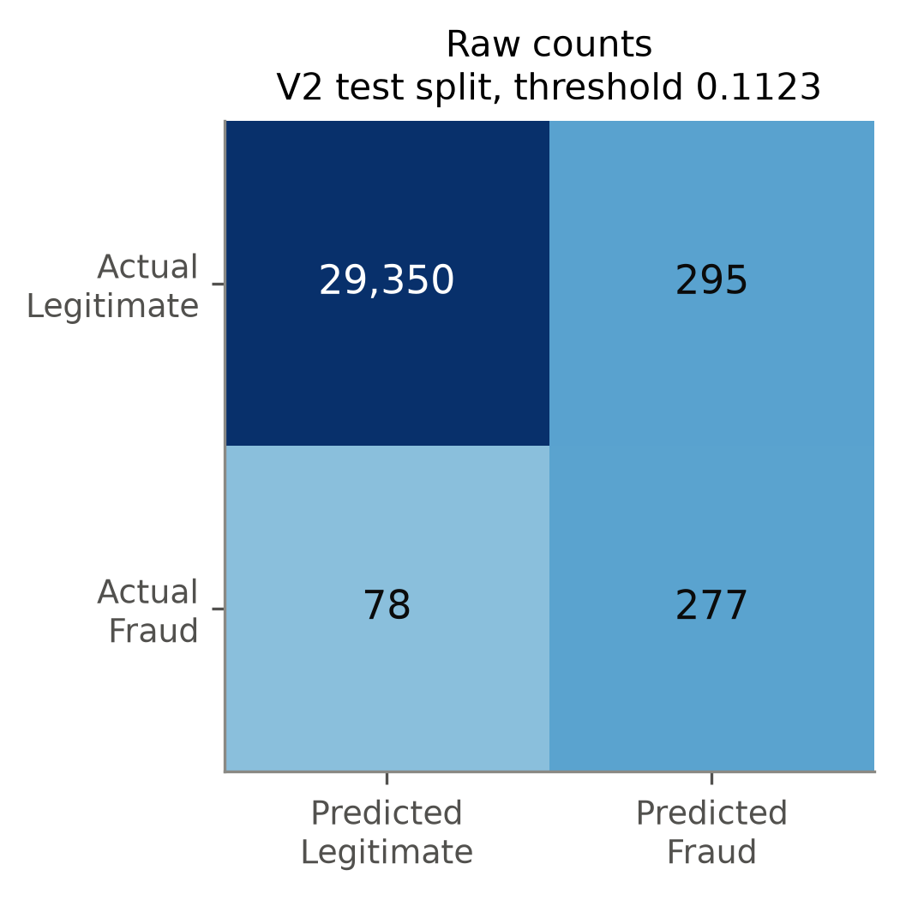

*Figure 1a — V2 test confusion matrix, raw counts (threshold 0.1123)* (`figures/fig01a_confusion_matrix.png`, `.svg`)

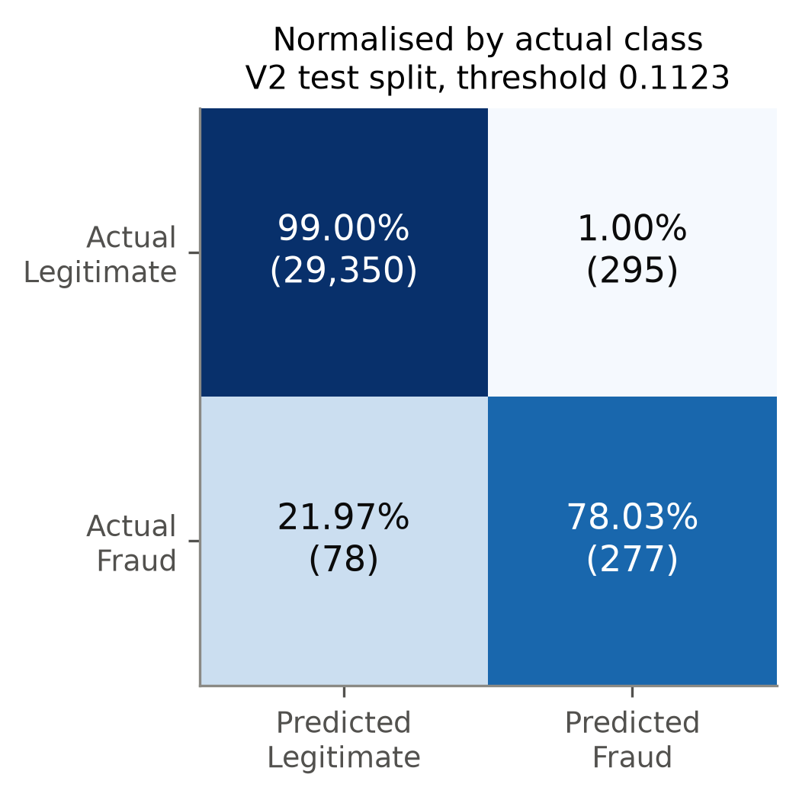

*Figure 1b — The same matrix normalised by actual class* (`figures/fig01b_confusion_matrix_normalised.png`, `.svg`)

Numerical matrix: `confusion_matrix/confusion_matrix_test.csv`. Of 29,645 legitimate payments 295 (0.995%) are flagged; of 355 fraudulent payments 277 are flagged and 78 missed (FNR 21.97%).

## 6. ROC Analysis

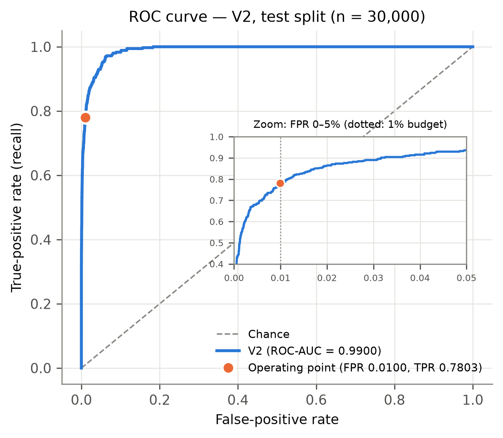

*Figure 2 — ROC curve, V2 test split (ROC-AUC 0.9900); operating point FPR 0.00995, TPR 0.7803; inset: FPR 0–5%* (`figures/fig02_roc_curve.png`, `.svg`)

**Demonstrates:** ROC-AUC 0.9900 on the test split. **Does NOT demonstrate:** practical usefulness by itself — with 29,645 legitimate payments even a small FPR produces many false alarms, which the ROC curve hides and the precision–recall curve shows. Curve points: `roc_pr/roc_curve_test.csv`.

## 7. Precision-Recall Analysis

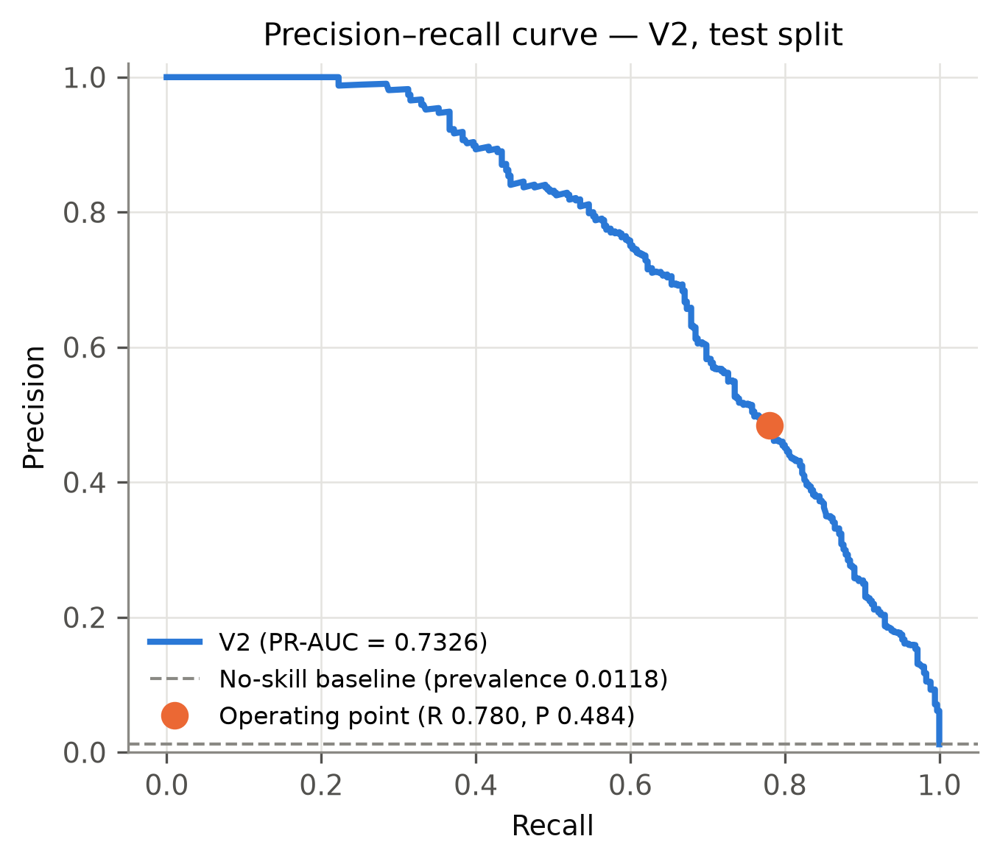

*Figure 3 — Precision–recall curve, V2 test split (PR-AUC 0.7326); dashed: prevalence 0.0118* (`figures/fig03_pr_curve.png`, `.svg`)

PR-AUC (average precision) is 0.7326, about 62× the no-skill baseline. At the operating point recall is 0.7803 and precision 0.4843: roughly one in two alerts is a true fraud under the synthetic prevalence. Precision depends on prevalence and would be lower at a lower real fraud rate. Curve points: `roc_pr/pr_curve_test.csv`.

## 8. Threshold Analysis

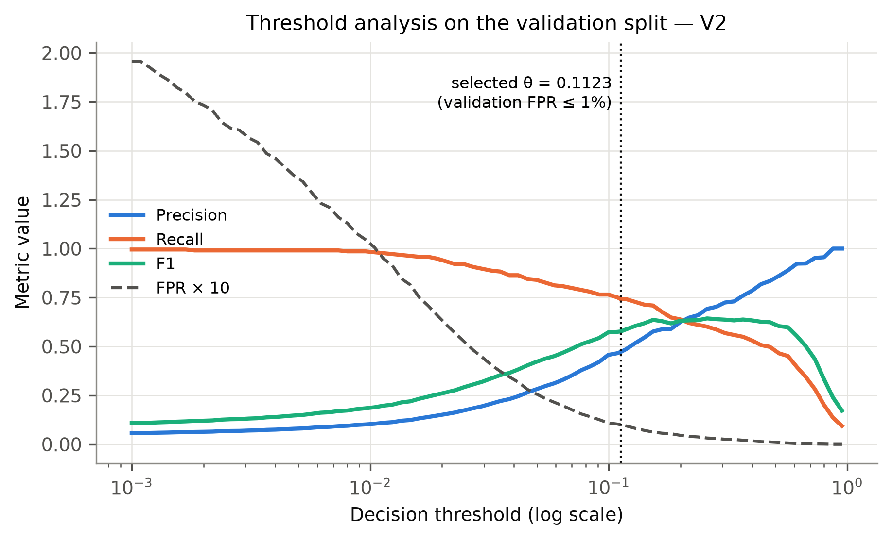

*Figure 6 — Precision, recall, F1 and FPR (×10) versus threshold on the validation split; dotted line: selected threshold* (`figures/fig06_threshold_analysis.png`, `.svg`)

### Table 4b — Selected operating point

| Split                   |   Threshold |   Recall |     FPR |   Precision |     F1 |   Specificity |   Predicted fraud rate |
|:------------------------|------------:|---------:|--------:|------------:|-------:|--------------:|-----------------------:|
| Validation (selection)  |      0.1123 |   0.7418 | 0.00995 |      0.4716 | 0.5766 |          0.99 |                 0.0186 |
| Test (frozen threshold) |      0.1123 |   0.7803 | 0.00995 |      0.4843 | 0.5976 |          0.99 |                 0.0191 |

Selection rule: highest validation recall with validation FPR ≤ 1% (train_model_v2.recall_at_fpr). Re-derived threshold 0.112265 → rounded 0.1123 (stored 0.1123).

The full sweep (81 thresholds from 0.001 to 0.95 plus the selected value, validation and test) is in `threshold/threshold_sweep.csv`. On validation the F1-maximising threshold in the grid is 0.2584 (F1 0.6432, recall 0.6009, FPR 0.00320); the project's rule instead fixes the false-positive budget at 1% and maximises recall inside it. The test columns of the sweep are provided for inspection only and were not used to choose anything.

## 9. Calibration Analysis

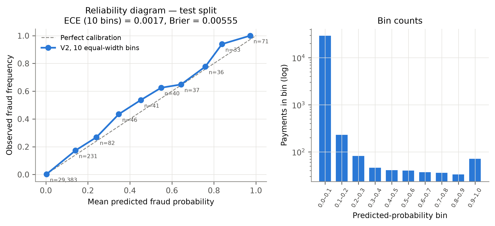

*Figure 4 — Reliability diagram (10 equal-width bins, test split) and bin counts* (`figures/fig04_reliability_diagram.png`, `.svg`)

| Bin | n | Fraud in bin | Mean predicted | Observed rate | |gap| |
|---|---|---|---|---|---|
| 0.0–0.1 | 29,383 | 72 | 0.0033 | 0.0025 | 0.0008 |
| 0.1–0.2 | 231 | 40 | 0.1410 | 0.1732 | 0.0322 |
| 0.2–0.3 | 82 | 22 | 0.2407 | 0.2683 | 0.0276 |
| 0.3–0.4 | 46 | 20 | 0.3474 | 0.4348 | 0.0874 |
| 0.4–0.5 | 41 | 22 | 0.4521 | 0.5366 | 0.0845 |
| 0.5–0.6 | 40 | 25 | 0.5488 | 0.6250 | 0.0762 |
| 0.6–0.7 | 37 | 24 | 0.6437 | 0.6486 | 0.0049 |
| 0.7–0.8 | 36 | 28 | 0.7595 | 0.7778 | 0.0183 |
| 0.8–0.9 | 33 | 31 | 0.8385 | 0.9394 | 0.1009 |
| 0.9–1.0 | 71 | 71 | 0.9726 | 1.0000 | 0.0274 |

- Test Brier score 0.00555 (Brier skill score 0.5251 against the base-rate predictor); ECE (10 equal-width bins) 0.0017; ECE with 10 quantile bins 0.0008 (only 4 distinct quantile bins exist because most predictions are near zero). Mean predicted probability 0.01176 vs observed rate 0.01183.
- **Interpretation:** the low ECE is dominated by the first bin, which holds 29,383 of 30,000 payments and is well calibrated (0.0033 predicted vs 0.0025 observed). In the 0.3–0.6 bins (127 payments) the model under-predicts: observed rates exceed mean predictions by 0.076–0.087. These bins hold 33–46 payments each, so their rates are imprecise. Calibration is good where most of the mass is and only approximate in the sparse upper range; it holds for this simulator and prevalence only.
- Validation: Brier 0.00592, ECE (10 bins) 0.0017. Bin tables: `calibration/`.

## 10. Risk Score Analysis

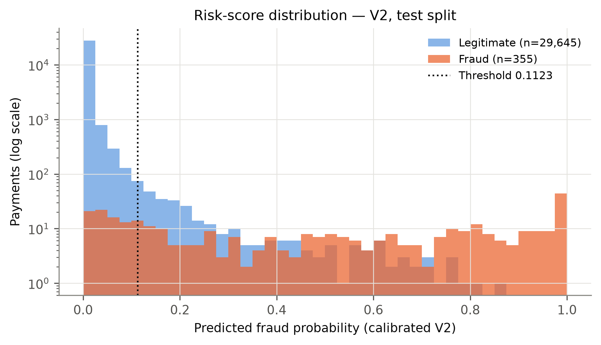

*Figure 5 — Distribution of the calibrated V2 fraud probability on the test split (log scale); dotted: threshold 0.1123* (`figures/fig05_risk_score_distribution.png`, `.svg`)

| Class | n | Mean | P05 | P25 | Median | P75 | P95 | Share ≥ threshold |
|---|---|---|---|---|---|---|---|---|
| legitimate | 29,645 | 0.0059 | 0.00000 | 0.00000 | 0.00004 | 0.00004 | 0.0260 | 0.0100 |
| fraud | 355 | 0.4992 | 0.02402 | 0.13124 | 0.50674 | 0.83009 | 1.0000 | 0.7803 |

Legitimate payments concentrate near zero (95th percentile 0.0260); fraudulent payments spread across the range (median 0.5067), and 22.0% of them fall below the threshold. The score is the classifier probability, not the ten-family risk R of Section 15.

## 11. Fraud Scenario Analysis

### Table 6 — Scenario-level fraud detection (V2, test split, threshold 0.1123)

| Scenario (synthetic)      |   Test fraud | Detected (TP)   | Missed (FN)   | Recall               |   Median probability |   Mean probability |
|:--------------------------|-------------:|:----------------|:--------------|:---------------------|---------------------:|-------------------:|
| Social engineering        |          182 | 120             | 62            | 0.6593               |              0.2838  |             0.3705 |
| Mule collection           |           80 | 68              | 12            | 0.8500               |              0.4309  |             0.438  |
| Account takeover          |           73 | 69              | 4             | 0.9452               |              0.8892  |             0.7859 |
| Card testing              |           20 | 20              | 0             | 1.0000               |              0.9876  |             0.8679 |
| Legitimate (false alarms) |        29645 | —               | —             | FPR 0.00995 (295 FP) |              4.1e-05 |             0.0059 |

Per-scenario precision and F1 are not reported: false positives are legitimate payments and belong to no scenario, so a scenario-specific precision is not defined. Scenario categories and proportions are simulator settings.

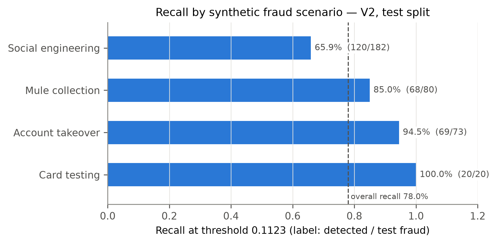

*Figure 11 — Recall by synthetic fraud scenario, V2 test split* (`figures/fig11_scenario_performance.png`, `.svg`)

**Demonstrates:** detection differs by scenario; social engineering, where the payer personally authorises the payment, is the hardest synthetic scenario (most of the 78 missed frauds). Account takeover and card testing, which change the payer's own behaviour, are almost all detected.  
**Does NOT demonstrate:** real-world per-scenario rates; the scenarios and their overlaps with legitimate behaviour are simulator designs.

## 12. Feature Importance

Method (as implemented in `scripts/evaluate_model_v2.py` and reproduced exactly here, max difference 9.5e-17): permutation importance on the frozen calibrated model, test split, scoring = average precision, 5 repeats; SHAP (TreeExplainer) on the uncalibrated booster of calibration fold 1, 200 test rows. Family importance shuffles all columns of a family together.

### Table 12a — Top 15 V2 features by permutation importance (test split)

|   Rank | Feature                           | Evidence family   |   Permutation importance (AP drop) |     sd |   Mean |SHAP| (booster) |
|-------:|:----------------------------------|:------------------|-----------------------------------:|-------:|------------------------:|
|      1 | payee_is_new                      | Relationship      |                             0.3656 | 0.0158 |                  0.8397 |
|      2 | arrival_span_days                 | Graph             |                             0.2455 | 0.0152 |                  0.2944 |
|      3 | amount_over_user_avg              | Payer behaviour   |                             0.2059 | 0.0145 |                  0.158  |
|      4 | msg_coercion_probability          | Message pressure  |                             0.1379 | 0.0105 |                  0.0755 |
|      5 | component_size                    | Graph             |                             0.1209 | 0.0037 |                  0.1488 |
|      6 | txns_last_hour                    | Payer behaviour   |                             0.1018 | 0.0056 |                  0.0472 |
|      7 | days_since_first_payment_to_payee | Relationship      |                             0.0765 | 0.0124 |                  0.0936 |
|      8 | seconds_since_last_txn            | Payer behaviour   |                             0.0732 | 0.0076 |                  0.081  |
|      9 | lifespan_days                     | Graph             |                             0.0587 | 0.0101 |                  0.072  |
|     10 | txns_today_over_avg               | Payer behaviour   |                             0.0534 | 0.0049 |                  0.0442 |
|     11 | payee_distinct_payers             | Payee history     |                             0.0383 | 0.0022 |                  0.0956 |
|     12 | payee_repeat_ratio                | Payee history     |                             0.0319 | 0.0049 |                  0.039  |
|     13 | intent_is_refund_or_asked         | Stated intent     |                             0.031  | 0.0052 |                  0.0387 |
|     14 | payee_is_phone_address            | Address and QR    |                             0.03   | 0.0044 |                  0.0844 |
|     15 | payee_age_days                    | Payee history     |                             0.0181 | 0.0056 |                  0.0523 |

Importance = mean drop in average precision when the column is shuffled (5 repeats). Correlated features share importance; importance is predictive usefulness under this protocol, not causal influence, and is distinct from the ten-family risk aggregation.

### Table 12b — Evidence-family importance (V2, test split)

| Family           |   Number of features |   Grouped permutation importance (AP drop) |     sd |   Sum of single-feature importances |
|:-----------------|---------------------:|-------------------------------------------:|-------:|------------------------------------:|
| Relationship     |                    4 |                                     0.4208 | 0.01   |                              0.4426 |
| Payer behaviour  |                    6 |                                     0.405  | 0.0152 |                              0.4476 |
| Graph            |                    7 |                                     0.3883 | 0.0145 |                              0.4345 |
| Message pressure |                   18 |                                     0.1702 | 0.0109 |                              0.1377 |
| Payee history    |                    4 |                                     0.0774 | 0.0055 |                              0.0883 |
| Stated intent    |                    3 |                                     0.0349 | 0.003  |                              0.0308 |
| Address and QR   |                    1 |                                     0.0292 | 0.0051 |                              0.03   |
| Amount context   |                    1 |                                     0.0113 | 0.0023 |                              0.0096 |
| Link safety      |                    3 |                                     0      | 0.001  |                             -0.0004 |

Grouped permutation importance shuffles all columns of a family together (5 repeats), which avoids splitting importance between correlated columns. The Classifier family has no input column of its own.

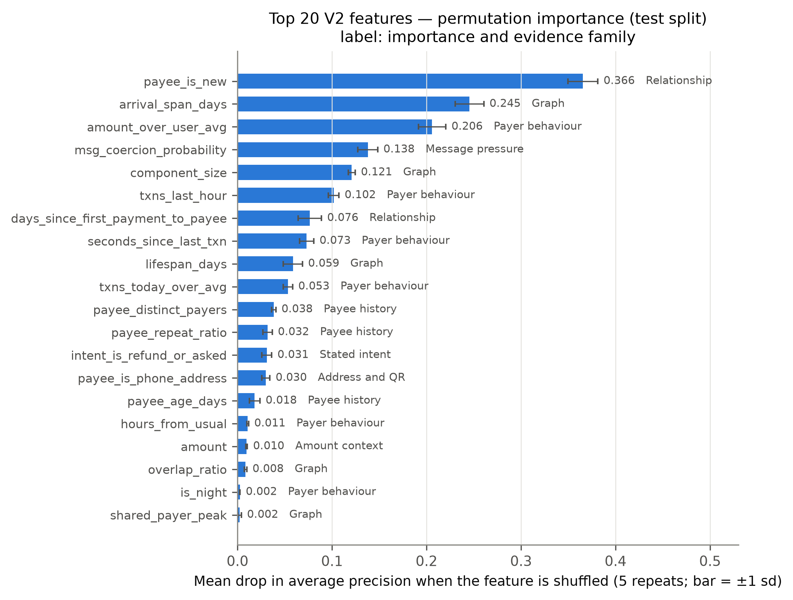

*Figure 7 — Top 20 V2 features by permutation importance (test split), coloured by evidence family* (`figures/fig07_feature_importance.png`, `.svg`)

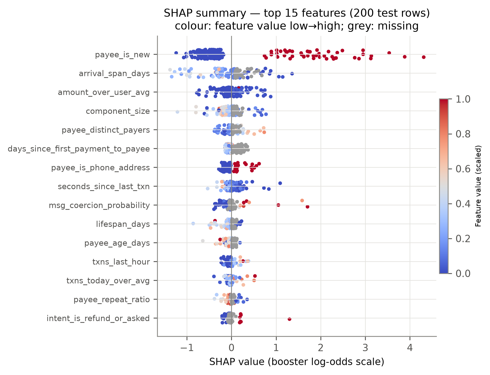

*Figure 7b — SHAP summary for the 15 features with the largest mean |SHAP| (uncalibrated booster, 200 test rows)* (`figures/fig07b_shap_summary.png`, `.svg`)

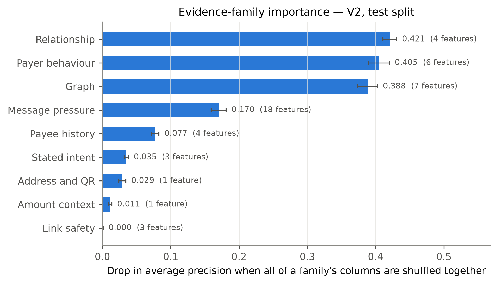

*Figure 8 — Evidence-family importance (grouped permutation, test split)* (`figures/fig08_family_importance.png`, `.svg`)

The five most useful single features are `payee_is_new` (0.3656), `arrival_span_days` (0.2455), `amount_over_user_avg` (0.2059), `msg_coercion_probability` (0.1379), `component_size` (0.1209). By family, Relationship, Payer behaviour and Graph dominate; link-safety columns contribute nothing measurable (0.0000). Importance is predictive usefulness under this protocol, not causal influence, and is separate from how the ten-family aggregation weighs evidence at run time.

## 13. V2 Feature-Family Ablation

**What was measured:** leave-family-out refits of V2 on seeds 42–51 (13 configurations × 10 seeds = 130 fits), identical splits, learner, calibration and validation-only threshold rule. **Category:** multi-seed result. The Full-V2 rows are refitted, not copied, and equal the ten-seed run of Section 14.

### Table 7 — V2 feature-family ablation (leave-family-out; mean over seeds 42–51)

| Configuration                                            |   F | PR-AUC          | ΔPR-AUC (pp)   |   ROC-AUC | ΔROC-AUC (pp)   |   Recall % | ΔRecall (pp)   |   FPR % |   Precision % |     F1 |   Brier |   SE recall % |   MC recall % |   AT recall % |   CT recall % | Seeds lower PR-AUC   |
|:---------------------------------------------------------|----:|:----------------|:---------------|----------:|:----------------|-----------:|:---------------|--------:|--------------:|-------:|--------:|--------------:|--------------:|--------------:|--------------:|:---------------------|
| A. Full V2                                               |  47 | 0.7196 ± 0.0228 | —              |    0.9882 | —               |      75.66 | —              |   0.991 |         48.16 | 0.5883 | 0.00573 |          62.4 |          83   |          93.6 |          97.3 | —                    |
| B. - Relationship                                        |  43 | 0.6844 ± 0.0245 | -3.52 ± 1.41   |    0.9777 | -1.05           |      71.02 | -4.64          |   1.029 |         45.73 | 0.5559 | 0.00601 |          54.2 |          80.5 |          94.8 |          94.8 | 10/10                |
| C. - Graph                                               |  40 | 0.6355 ± 0.0213 | -8.41 ± 0.90   |    0.9825 | -0.57           |      67.76 | -7.90          |   0.985 |         45.58 | 0.5447 | 0.00672 |          55.7 |          64.2 |          93.2 |          95.6 | 10/10                |
| D. - Message pressure                                    |  29 | 0.6735 ± 0.0220 | -4.61 ± 1.70   |    0.9846 | -0.36           |      69.73 | -5.93          |   1.002 |         45.96 | 0.5531 | 0.00622 |          51.4 |          81.4 |          93.2 |          96.9 | 10/10                |
| E. - Link safety                                         |  44 | 0.7203 ± 0.0200 | +0.07 ± 0.71   |    0.9883 | +0.01           |      76.07 | +0.41          |   1.025 |         47.48 | 0.5844 | 0.00572 |          62.9 |          83.4 |          93.8 |          97.6 | 6/10                 |
| F. - Stated intent                                       |  44 | 0.6851 ± 0.0245 | -3.45 ± 1.40   |    0.9859 | -0.23           |      72.68 | -2.98          |   0.992 |         47.17 | 0.5717 | 0.00609 |          56.8 |          83   |          92.3 |          98   | 10/10                |
| G. - Contextual (message+link+intent)                    |  23 | 0.6232 ± 0.0235 | -9.64 ± 2.27   |    0.9799 | -0.83           |      63.5  | -12.16         |   1.031 |         42.92 | 0.5115 | 0.00671 |          39.4 |          81.8 |          92.4 |          96.5 | 10/10                |
| H. - Relational (relationship+graph)                     |  36 | 0.5961 ± 0.0253 | -12.35 ± 1.59  |    0.9681 | -2.01           |      63.31 | -12.35         |   1.03  |         42.86 | 0.5107 | 0.00706 |          47   |          64.7 |          92.8 |          93.6 | 10/10                |
| I. - Payee history                                       |  43 | 0.7001 ± 0.0207 | -1.95 ± 0.87   |    0.9868 | -0.14           |      74.85 | -0.81          |   1.013 |         47.38 | 0.5798 | 0.00596 |          61.4 |          82   |          93.1 |          97.3 | 10/10                |
| J. - Payer behaviour                                     |  41 | 0.5593 ± 0.0304 | -16.03 ± 2.29  |    0.9789 | -0.93           |      62.37 | -13.28         |   1.012 |         42.99 | 0.5084 | 0.00749 |          59.8 |          76.6 |          48.2 |          75.1 | 10/10                |
| K. - Amount context                                      |  46 | 0.7182 ± 0.0246 | -0.14 ± 0.40   |    0.9882 | +0.00           |      75.61 | -0.05          |   0.985 |         48.37 | 0.5895 | 0.00574 |          62.3 |          82.9 |          93.4 |          97.6 | 7/10                 |
| L. - Address and QR                                      |  46 | 0.7068 ± 0.0215 | -1.28 ± 1.06   |    0.9873 | -0.09           |      75.2  | -0.46          |   0.996 |         47.91 | 0.5849 | 0.00588 |          61.8 |          81.9 |          94.1 |          97.3 | 9/10                 |
| M. - All payee-side (history+relationship+graph+address) |  31 | 0.4450 ± 0.0387 | -27.46 ± 3.06  |    0.9106 | -7.76           |      47.62 | -28.04         |   0.993 |         36.95 | 0.4157 | 0.00838 |          35.3 |          20.7 |          95.3 |          89.7 | 10/10                |

Every configuration is refitted with the identical protocol (same splits, learner, calibration and validation-only threshold rule). Δ = configuration minus full V2 on the same seed (paired), mean ± sd over seeds, in percentage points. Families follow scripts/final_v2/families.py. Contextual = message + link + intent; Relational = relationship + graph. SE, MC, AT, CT: synthetic scenario recall. Differences are associations under the simulator, not causal effects.

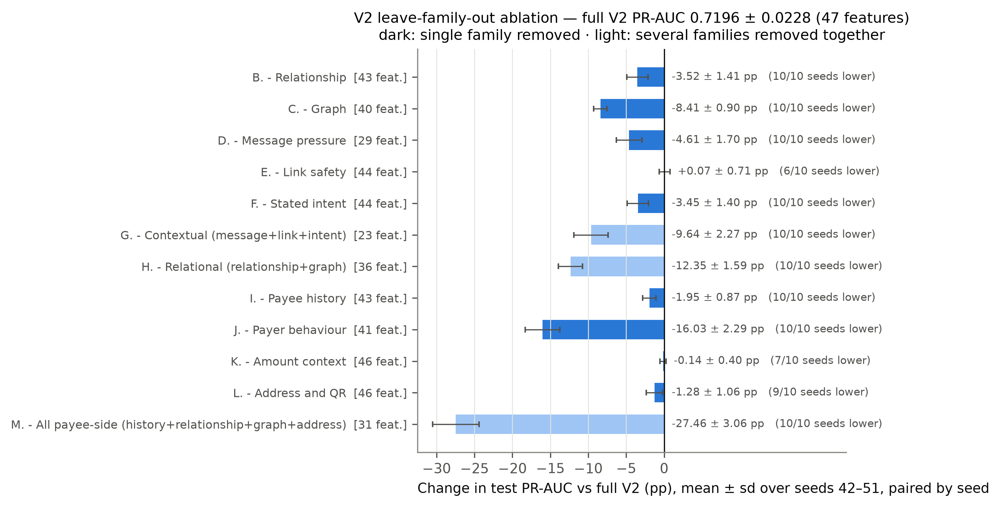

*Figure 9 — Change in test PR-AUC when each family (or group of families) is removed, mean ± sd over ten seeds* (`figures/fig09_v2_ablation.png`, `.svg`)

Paired changes in PR-AUC relative to Full V2 (largest loss first): M. - All payee-side (history+relationship+graph+address) -27.46 pp (lower on 10/10 seeds); J. - Payer behaviour -16.03 pp (lower on 10/10 seeds); H. - Relational (relationship+graph) -12.35 pp (lower on 10/10 seeds); G. - Contextual (message+link+intent) -9.64 pp (lower on 10/10 seeds); C. - Graph -8.41 pp (lower on 10/10 seeds); D. - Message pressure -4.61 pp (lower on 10/10 seeds); B. - Relationship -3.52 pp (lower on 10/10 seeds); F. - Stated intent -3.45 pp (lower on 10/10 seeds); I. - Payee history -1.95 pp (lower on 10/10 seeds); L. - Address and QR -1.28 pp (lower on 9/10 seeds); K. - Amount context -0.14 pp (lower on 7/10 seeds); E. - Link safety +0.07 pp (lower on 6/10 seeds).

- **Graph:** removing it lowers PR-AUC by -8.41 ± 0.90 pp and mule-collection recall from 83.0% to 64.2%.
- **Message pressure:** -4.61 ± 1.70 pp; social-engineering recall 62.4% → 51.4%.
- **Payer behaviour:** -16.03 ± 2.29 pp; account-takeover recall 93.6% → 48.2% and card-testing 97.3% → 75.1%.
- **Link safety** (+0.07 ± 0.71 pp) and **amount context** (-0.14 ± 0.40 pp) show no difference distinguishable from seed-to-seed variation.
- **All payee-side evidence removed** (history + relationship + graph + address): -27.46 ± 3.06 pp; mule-collection recall falls to 20.7%.

Single-split version on the original seed-42 split: `tables/table07b_v2_family_ablation_seed42.md`. **Does NOT demonstrate:** that a family *causes* detection; each channel was generated with scenario-conditional probabilities chosen by the designers, so the ablation measures how much of that designed signal the learner recovers.

## 14. Ten-Seed Stability

### Table 8 — V2 ten-seed stability (seeds 42–51; test split of 30,000 per seed)

| Metric                          |     Mean |     SD |      Min |       Max |   Seed 42 (original run) |
|:--------------------------------|---------:|-------:|---------:|----------:|-------------------------:|
| PR-AUC                          |  0.7196  | 0.0228 |  0.6829  |   0.7693  |                  0.7326  |
| ROC-AUC                         |  0.9882  | 0.0021 |  0.9833  |   0.9911  |                  0.99    |
| Recall at ~1% FPR (%)           | 75.66    | 3.16   | 70.75    |  80.99    |                 78.03    |
| Realised test FPR (%)           |  0.991   | 0.078  |  0.901   |   1.174   |                  0.995   |
| Precision (%)                   | 48.16    | 2.44   | 44.41    |  52.41    |                 48.43    |
| F1                              |  0.5883  | 0.0243 |  0.5564  |   0.6364  |                  0.5976  |
| Brier score                     |  0.00573 | 0.0003 |  0.00516 |   0.00614 |                  0.00555 |
| Brier skill score               |  0.5166  | 0.023  |  0.4858  |   0.5687  |                  0.5251  |
| Validation threshold            |  0.1326  | 0.0143 |  0.1123  |   0.1544  |                  0.1123  |
| Recall — social engineering (%) | 62.36    | 4.48   | 55.98    |  67.82    |                 65.93    |
| Recall — mule collection (%)    | 82.98    | 3.73   | 76.47    |  89.29    |                 85       |
| Recall — account takeover (%)   | 93.64    | 3.12   | 88.89    |  98.67    |                 94.52    |
| Recall — card testing (%)       | 97.26    | 3.08   | 92.59    | 100       |                100       |

Each seed regenerates the corpus, re-splits (stratified, random_state = seed), refits the calibrated V2 model, selects the threshold on its own validation split (FPR ≤ 1%) and measures the test split once. Statistics are over the ten seed-level values (sd with ddof = 1). Seed 42 reproduces the frozen V2 artefact exactly.

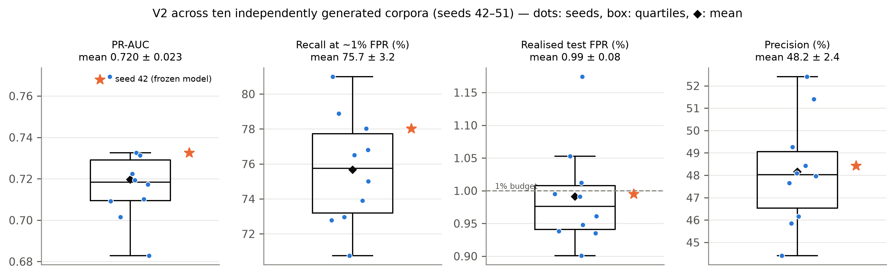

*Figure 10 — V2 across seeds 42–51 (boxes: ten seed-level values; star: seed 42)* (`figures/fig10_ten_seed_stability.png`, `.svg`)

- PR-AUC 0.7196 ± 0.0228 (range 0.6829–0.7693); recall at ~1% FPR 75.66 ± 3.16%; realised test FPR 0.991 ± 0.078%.
- The original seed-42 run (PR-AUC 0.7326) ranks 2 of 10 by PR-AUC; it lies inside the multi-seed range but above the mean, so the single-split number slightly overstates typical performance.
- Validation FPR ≤ 1% on all seeds (True); the test FPR exceeds 1% on 3 seeds (max 1.174%) — ordinary transfer variation of a validation-chosen threshold.
- Test fraud per seed: 355, 371, 362, 363, 341, 360, 352, 383, 355, 359. Test sets were never pooled and no seed was selected.
- **Template-disjoint control** (leakage check, Section 20 item 12): with test messages drawn only from templates unseen in training and the coercion model refitted on the training half, full-V2 PR-AUC is 0.7155 ± 0.0219 (paired Δ -0.42 ± 0.71 pp) — `results/ablation/template_disjoint_summary.json`.

## 15. Full Ten-Family End-to-End Evaluation

**What was measured:** the complete assessment (ten families, aggregation, verdicts) on three chronological replay streams (seeds 42–44; 60,000 payments, 150 days, 2,000 payers, 900 merchants, 720 frauds each), assessed payment by payment from the pre-payment state (Section 18). **Configuration:** the running prototype serves an older model in its Classifier family; for this V2-only report that family is replaced by the frozen V2 model, scored with the production mapping (graded 0–18 below the threshold, 30–66 above; counterfactual fact attribution) on the V2 vector the replay built for each payment from the same pre-payment state. The other nine families are exactly as `payee_check.check_payee` computed them, and risk, coverage, level and verdict are recomputed with the production functions (the same re-aggregation reproduced every recorded replay output with 0 mismatches over 180,000 payments). The primary slice is the last 25% of each stream (days ≈112–150), after the shared store has warmed up.

### Table 9 — Ten-family end-to-end evaluation (chronological replay, V2 as the Classifier family)

| Slice                             | Quantity                                                                  | Value (mean ± sd over 3 streams)   |
|:----------------------------------|:--------------------------------------------------------------------------|:-----------------------------------|
| Last 25% of each stream (primary) | Payments / fraud per stream                                               | 15,000 / 211 ± 36                  |
| Last 25% of each stream (primary) | Fraud prevalence (%)                                                      | 1.40 ± 0.24                        |
| Last 25% of each stream (primary) | Ten-family risk R — PR-AUC                                                | 0.120 ± 0.017                      |
| Last 25% of each stream (primary) | Ten-family risk R — ROC-AUC                                               | 0.850 ± 0.016                      |
| Last 25% of each stream (primary) | Frozen V2 probability alone — PR-AUC (rows where the family is available) | 0.246 ± 0.013                      |
| Last 25% of each stream (primary) | Frozen V2 probability alone — ROC-AUC (same rows)                         | 0.901 ± 0.019                      |
| Last 25% of each stream (primary) | Frozen V2 alone at θ = 0.1123 — recall / FPR (%)                          | 10.8 ± 3.0 / 0.25 ± 0.04           |
| Last 25% of each stream (primary) | Verdict WARN or above — recall / FPR (%)                                  | 83.0 ± 2.6 / 31.1 ± 0.6            |
| Last 25% of each stream (primary) | Verdict STEP_UP or above — recall / FPR (%)                               | 67.8 ± 3.7 / 12.6 ± 0.9            |
| Last 25% of each stream (primary) | Verdict BLOCK — recall / FPR (%)                                          | 51.0 ± 6.4 / 6.78 ± 0.58           |
| Last 25% of each stream (primary) | Intervention rate, all payments (non-APPROVE, %)                          | 31.9 ± 0.7                         |
| Full stream                       | Payments / fraud per stream                                               | 60,000 / 720 ± 0                   |
| Full stream                       | Fraud prevalence (%)                                                      | 1.20 ± 0.00                        |
| Full stream                       | Ten-family risk R — PR-AUC                                                | 0.047 ± 0.004                      |
| Full stream                       | Ten-family risk R — ROC-AUC                                               | 0.774 ± 0.010                      |
| Full stream                       | Frozen V2 probability alone — PR-AUC (rows where the family is available) | 0.119 ± 0.012                      |
| Full stream                       | Frozen V2 probability alone — ROC-AUC (same rows)                         | 0.875 ± 0.020                      |
| Full stream                       | Frozen V2 alone at θ = 0.1123 — recall / FPR (%)                          | 8.7 ± 0.9 / 0.50 ± 0.02            |
| Full stream                       | Verdict WARN or above — recall / FPR (%)                                  | 84.2 ± 1.2 / 52.3 ± 1.0            |
| Full stream                       | Verdict STEP_UP or above — recall / FPR (%)                               | 69.4 ± 1.9 / 23.8 ± 0.6            |
| Full stream                       | Verdict BLOCK — recall / FPR (%)                                          | 50.9 ± 1.4 / 12.99 ± 0.45          |
| Full stream                       | Intervention rate, all payments (non-APPROVE, %)                          | 52.7 ± 1.0                         |

Verdicts are advisory states of the risk score, not ground-truth classes; recall/FPR at a verdict level are operating points of R. Three replay streams (seeds 42–44), 60,000 payments each; the last 25% (days ≈112–150) follows a warm-up of the shared store.

### Table 9b — Verdict distribution by group (last 25% of each stream)

| Group (last 25%)      | n per stream          | APPROVE % (counts)             | WARN % (counts)             | STEP_UP % (counts)      | BLOCK % (counts)           |
|:----------------------|:----------------------|:-------------------------------|:----------------------------|:------------------------|:---------------------------|
| All payments          | 15000 / 15000 / 15000 | 68.1 ± 0.7 (10308/10099/10252) | 18.5 ± 0.5 (2726/2743/2851) | 6.0 ± 0.5 (825/984/886) | 7.4 ± 0.6 (1141/1174/1011) |
| Legitimate            | 14828 / 14758 / 14782 | 68.9 ± 0.6 (10284/10054/10212) | 18.5 ± 0.5 (2702/2704/2817) | 5.8 ± 0.5 (801/937/849) | 6.8 ± 0.6 (1041/1063/904)  |
| Fraud (all scenarios) | 172 / 242 / 218       | 17.0 ± 2.6 (24/45/40)          | 15.2 ± 1.1 (24/39/34)       | 16.8 ± 2.7 (24/47/37)   | 51.0 ± 6.4 (100/111/107)   |
| Social engineering    | 70 / 124 / 94         | 4.6 ± 4.9 (0/12/4)             | 8.0 ± 3.5 (3/14/8)          | 16.2 ± 6.7 (6/26/18)    | 71.1 ± 14.8 (61/72/64)     |
| Mule collection       | 50 / 49 / 52          | 0.0 ± 0.0 (0/0/0)              | 21.2 ± 0.8 (11/10/11)       | 19.9 ± 2.6 (10/11/9)    | 58.9 ± 2.3 (29/28/32)      |
| Account takeover      | 41 / 50 / 54          | 37.0 ± 3.4 (14/18/22)          | 23.4 ± 2.3 (9/13/12)        | 18.7 ± 0.8 (8/9/10)     | 21.0 ± 3.1 (10/10/10)      |
| Card testing          | 11 / 19 / 18          | 82.5 ± 7.3 (10/15/14)          | 12.1 ± 4.0 (1/2/3)          | 1.8 ± 3.0 (0/1/0)       | 3.6 ± 3.1 (0/1/1)          |

Rates are mean ± sd over the three streams; counts are per stream (seed 42 / 43 / 44). Scenario groups contain fraudulent payments only.

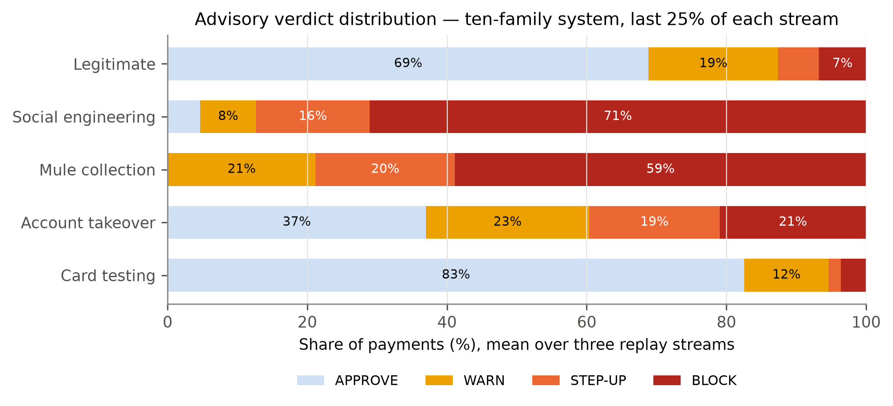

*Figure 12 — Advisory verdict distribution by group, last 25% of each stream (mean over three streams)* (`figures/fig12_verdict_distribution.png`, `.svg`)

### Table 9f — Evidence-family behaviour in the complete system (last 25%, mean ± sd over 3 streams)

| Family           | Available %   | Active on fraud %   | Active on legitimate %   | AUC of family score (where available)   | Leads fraud assessments %   |
|:-----------------|:--------------|:--------------------|:-------------------------|:----------------------------------------|:----------------------------|
| Payee history    | 100.0 ± 0.0   | 44.2 ± 5.8          | 11.0 ± 0.7               | 0.68 ± 0.03                             | 15.3 ± 4.1                  |
| Relationship     | 100.0 ± 0.0   | 0.0 ± 0.0           | 0.0 ± 0.0                | n/a                                     | 0.0 ± 0.0                   |
| Payer behaviour  | 100.0 ± 0.0   | 90.3 ± 0.2          | 33.0 ± 0.5               | 0.83 ± 0.01                             | 34.9 ± 3.5                  |
| Classifier (V2)  | 98.9 ± 0.2    | 74.7 ± 2.9          | 11.6 ± 0.7               | 0.86 ± 0.03                             | 2.6 ± 1.4                   |
| Address and QR   | 100.0 ± 0.0   | 14.5 ± 6.6          | 0.0 ± 0.0                | 0.57 ± 0.03                             | 8.0 ± 8.2                   |
| Graph            | 91.1 ± 0.1    | 0.3 ± 0.5           | 0.0 ± 0.0                | 0.51                                    | 0.0 ± 0.0                   |
| Amount context   | 100.0 ± 0.0   | 14.2 ± 2.0          | 1.2 ± 0.1                | 0.57 ± 0.01                             | 3.8 ± 0.2                   |
| Message pressure | 54.6 ± 0.1    | 21.5 ± 2.2          | 13.5 ± 0.2               | 0.67 ± 0.02                             | 12.9 ± 1.1                  |
| Link safety      | 100.0 ± 0.0   | 8.6 ± 0.7           | 2.4 ± 0.2                | 0.53 ± 0.00                             | 4.2 ± 0.3                   |
| Stated intent    | 42.0 ± 0.2    | 33.9 ± 2.7          | 17.7 ± 0.5               | 0.75 ± 0.02                             | 13.9 ± 2.8                  |

Active = family available and scored above zero. Leads = the family has the highest score in a fraudulent assessment.

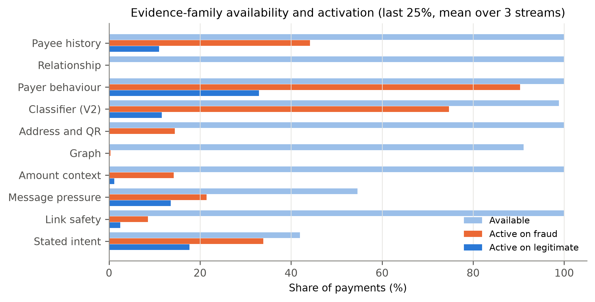

*Figure 13b — Evidence-family availability and activation* (`figures/fig13b_family_availability.png`, `.svg`)

- **Continuous risk:** R reaches PR-AUC 0.1198 ± 0.0170 and ROC-AUC 0.8504 ± 0.0158; the frozen V2 probability alone reaches 0.2462 ± 0.0133 and 0.9012 ± 0.0191 on the payments where its family is available. With V2 as the classifier, the rule-based aggregation ranks fraud *less* well than the V2 probability alone on this stream.
- **Transfer:** V2 was trained on the row-level corpus; on the replay streams its stored threshold recalls only 10.8 ± 3.0% of fraud (FPR 0.25 ± 0.04%). The two simulators differ, and the classifier's operating point does not transfer between them.
- **Verdicts:** legitimate payments receive APPROVE 68.9 ± 0.6%, WARN 18.5 ± 0.5%, STEP_UP 5.8 ± 0.5%, BLOCK 6.8 ± 0.6%. Social-engineering payments are blocked in 71.1 ± 14.8% and mule-collection payments in 58.9 ± 2.3%; card-testing probes are approved in 82.5 ± 7.3%.
- **Operating points of R:** WARN or above recalls 83.0 ± 2.6% of fraud at FPR 31.1 ± 0.6%; BLOCK recalls 51.0 ± 6.4% at FPR 6.78 ± 0.58%.

**Demonstrates:** how the complete rule-based system behaves on a synthetic chronological stream: it blocks most social-engineering and mule-collection payments but, with its fixed (untuned) rule weights and verdict bands, it intervenes on roughly a third of legitimate payments and blocks about 7%.  
**Does NOT demonstrate:** a four-class classifier — APPROVE/WARN/STEP_UP/BLOCK are advisory bands of one score, not ground-truth classes; nor real-world intervention rates.

**Why legitimate payments are blocked** (last 25%, V2 rows; 1,041 / 1,063 / 904 legitimate BLOCKs per stream). Family with the highest score in the assessment: stated intent 50.8 ± 4.7%; message pressure 25.7 ± 2.8%; payee history 13.0 ± 9.0%; link safety 5.6 ± 0.9%; payer behaviour 3.5 ± 1.0%; amount context 1.3 ± 0.2%. A refund purpose (`paying_for_a_refund`) appears in 50.1 ± 4.4% of these BLOCKs. The Classifier (V2) family almost never leads a legitimate BLOCK; legitimate BLOCKs come mainly from the fixed stated-intent and message-pressure rules.

## 16. Evidence Coverage Analysis

Coverage C (0–100) is a weighted count of available families (fixed weights: payee history 24, relationship 18, payer behaviour 16, classifier 12, address/QR 11, graph 8, amount 5, message 3, link 2, intent 1). It is computed only from availability and never from scores.

### Table 9c — Evidence coverage C (last 25% of each stream)

|   Stream |   Coverage mean |   Median |   Min |   Max |   Legitimate mean |   Fraud mean |   Level FULL (n) |   Level PARTIAL (n) |   Payee status NEW_TO_USER_BUT_OBSERVED mean |   Payee status PAID_BEFORE mean |   Payee status PAID_OFTEN mean |   Payee status PAID_ONCE mean |   Payee status UNKNOWN mean |
|---------:|----------------:|---------:|------:|------:|------------------:|-------------:|-----------------:|--------------------:|---------------------------------------------:|--------------------------------:|-------------------------------:|------------------------------:|----------------------------:|
|       42 |           97.2  |       97 |    68 |   100 |             97.21 |        95.9  |            14999 |                   1 |                                         97.6 |                            98.1 |                           98.1 |                          98   |                        89.6 |
|       43 |           97.2  |       97 |    63 |   100 |             97.22 |        95.87 |            14998 |                   2 |                                         97.6 |                            98.1 |                           98.1 |                          97.9 |                        89.8 |
|       44 |           97.22 |       97 |    64 |   100 |             97.23 |        96.73 |            14993 |                   7 |                                         97.7 |                            98   |                           98.1 |                          98   |                        89.7 |

Coverage (0–100) depends only on which families were available (fixed weights, evidence.CONFIDENCE_WEIGHT); it is not a risk score.

### Table 9d — Evidence coverage C by evidence level (full streams)

|   Stream |   Coverage mean |   Median |   Min |   Max |   Level FULL (n) |   Level PARTIAL (n) | FULL: mean / median / min / max   | PARTIAL: mean / median / min / max   |
|---------:|----------------:|---------:|------:|------:|-----------------:|--------------------:|:----------------------------------|:-------------------------------------|
|       42 |           93.97 |       97 |    60 |   100 |            58003 |                1997 | 94.9 / 97 / 76 / 100              | 65.8 / 64 / 60 / 72                  |
|       43 |           93.81 |       97 |    60 |   100 |            58001 |                1999 | 94.8 / 97 / 76 / 100              | 65.5 / 64 / 60 / 72                  |
|       44 |           93.93 |       97 |    60 |   100 |            58002 |                1998 | 94.9 / 97 / 76 / 100              | 65.6 / 64 / 60 / 72                  |

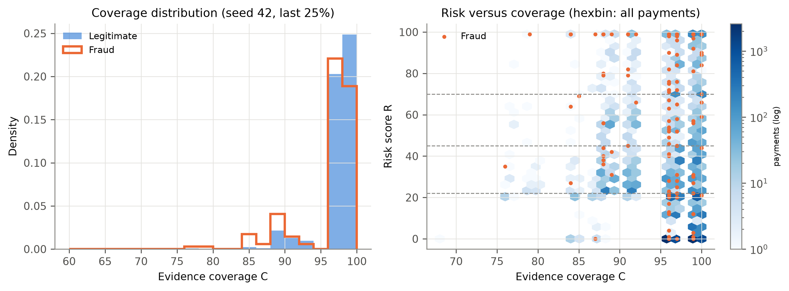

*Figure 13 — Coverage distribution by label and risk versus coverage (seed 42, last 25%)* (`figures/fig13_coverage.png`, `.svg`)

### Table 9e — Missing evidence is neither 'safe' nor 'fraud' (full streams)

|   Stream | Family           |   Unavailable payments |   Median R when unavailable |   Median R when available |   Share R = 0 when unavailable |   Share BLOCK when unavailable |   Fraud rate when unavailable |
|---------:|:-----------------|-----------------------:|----------------------------:|--------------------------:|-------------------------------:|-------------------------------:|------------------------------:|
|       42 | Graph            |                  12020 |                          27 |                        20 |                         0      |                         0.0721 |                        0.0082 |
|       42 | Message pressure |                  27162 |                          20 |                        23 |                         0.338  |                         0.1089 |                        0.0141 |
|       42 | Classifier (V2)  |                   9799 |                          32 |                        20 |                         0.0576 |                         0.2625 |                        0.0184 |
|       42 | Payer behaviour  |                   1997 |                          14 |                        22 |                         0.0926 |                         0.2379 |                        0.011  |
|       42 | Stated intent    |                  34914 |                          20 |                        33 |                         0.3765 |                         0.0906 |                        0.0123 |
|       43 | Graph            |                  13050 |                          27 |                        20 |                         0      |                         0.0767 |                        0.0079 |
|       43 | Message pressure |                  27278 |                          22 |                        23 |                         0.3179 |                         0.1186 |                        0.015  |
|       43 | Classifier (V2)  |                   9862 |                          30 |                        20 |                         0.0502 |                         0.258  |                        0.0142 |
|       43 | Payer behaviour  |                   1999 |                          14 |                        23 |                         0.0855 |                         0.2381 |                        0.0085 |
|       43 | Stated intent    |                  34695 |                          20 |                        36 |                         0.3605 |                         0.0975 |                        0.0118 |
|       44 | Graph            |                  12296 |                          27 |                        20 |                         0      |                         0.0754 |                        0.0076 |
|       44 | Message pressure |                  26989 |                          22 |                        23 |                         0.3248 |                         0.1127 |                        0.0142 |
|       44 | Classifier (V2)  |                   9846 |                          30 |                        20 |                         0.0562 |                         0.2558 |                        0.0166 |
|       44 | Payer behaviour  |                   1998 |                          14 |                        22 |                         0.0986 |                         0.2262 |                        0.0105 |
|       44 | Stated intent    |                  34842 |                          20 |                        35 |                         0.3632 |                         0.0938 |                        0.0116 |

Families that were available on every payment (payee history, relationship, address and QR, amount context, link safety) are not listed.

**Verification that missing evidence is neither 'safe' nor 'fraud':**

1. In the implementation, `evidence.Evidence` raises an error if an unavailable family carries a score or facts, so an unavailable family contributes nothing to R (it cannot lower or raise risk by being absent); coverage records the absence separately.
2. Measured: across the replay no unavailable family carried a score (0 cases), and payments with an unavailable family are neither set to R = 0 nor blocked wholesale — e.g. seed 42, Classifier family unavailable on 9,799 payments (payer with fewer than 5 prior payments): median R 32.0 vs 20.0 when available; share with R = 0: 5.8%; share BLOCK: 26.2%. Their verdicts come from the evidence that *was* available.
3. Unit tests covering the same property pass (`test_evidence_availability`, `test_evidence_model`; Section 19).

Coverage is high for both classes (full stream, seed 42: mean 94.0, median 97, range 60–100); it is lower for payments to UNKNOWN payees (no prior observation), as intended. High coverage does not imply low risk.

## 17. Graph Analysis

The implementation maintains an **explicit incremental payer–payee graph** in the same database transaction that records a payment: per-pair edges (`payee_payers`: payment count, first/last timestamps), per-payee aggregates (`payee_graph_cache`: distinct payers, repeat payers, arrival window) and a persisted union–find over payer and payee nodes (`graph_components`). The assessment reads it through `graph_cache.graph_view`. **It is not a graph neural network and computes no embeddings.** Statistics below are read from the replay stores (end of each 150-day stream) and cross-checked against an independent union–find built from the transaction files.

### Table 13 — Replayed payer–payee graph (end of each 150-day stream) and graph evidence at assessment time

|   Stream |   Payments observed |   Payer nodes |   Payee nodes |   Payer–payee edges |   Repeat edges (≥2 payments) |   Single-payment edges | Payee in-degree mean / median / max   | Payer out-degree mean / median / max   |   Connected components |   Largest component (nodes) | Components = independent rebuild   | Aggregates = edges   |   Payees ≥10 payers |   Graph evidence available at assessment (%) | Positional finding fired (fraud / legit)   |   Payments with shape findings |
|---------:|--------------------:|--------------:|--------------:|--------------------:|-----------------------------:|-----------------------:|:--------------------------------------|:---------------------------------------|-----------------------:|----------------------------:|:-----------------------------------|:---------------------|--------------------:|---------------------------------------------:|:-------------------------------------------|-------------------------------:|
|       42 |               60000 |          1997 |         12020 |               29393 |                        11952 |                  17441 | 2.45 / 1 / 1480                       | 14.72 / 13 / 55                        |                      7 |                       14000 | True                               | True                 |                 313 |                                        79.97 | 1 / 0                                      |                          17181 |
|       43 |               60000 |          1999 |         13050 |               30776 |                        11783 |                  18993 | 2.36 / 1 / 1422                       | 15.40 / 14 / 54                        |                      8 |                       15030 | True                               | True                 |                 321 |                                        78.25 | 4 / 0                                      |                          16642 |
|       44 |               60000 |          1998 |         12296 |               30277 |                        11887 |                  18390 | 2.46 / 1 / 1234                       | 15.15 / 14 / 51                        |                      5 |                       14279 | True                               | True                 |                 300 |                                        79.51 | 13 / 0                                     |                          17078 |

Explicit incremental graph maintained by the running store (payee_payers edges, payee_graph_cache aggregates, graph_components union–find). No graph neural network and no embeddings exist in the implementation. Component counts are cross-checked by an independent union–find built from the transaction file.

### Table 13b — Relationship state at assessment time (payee_status)

|   Stream | Label      |   NEW_TO_USER_BUT_OBSERVED |   PAID_BEFORE |   UNKNOWN |   PAID_ONCE |   PAID_OFTEN |
|---------:|:-----------|---------------------------:|--------------:|----------:|------------:|-------------:|
|       42 | legitimate |                      16873 |         14263 |     11922 |       11894 |         4328 |
|       42 | fraud      |                        500 |            52 |        98 |          58 |           12 |
|       43 | legitimate |                      17235 |         13540 |     12947 |       11723 |         3835 |
|       43 | fraud      |                        491 |            57 |       103 |          60 |            9 |
|       44 | legitimate |                      17489 |         13740 |     12203 |       11836 |         4012 |
|       44 | fraud      |                        492 |            66 |        93 |          51 |           18 |

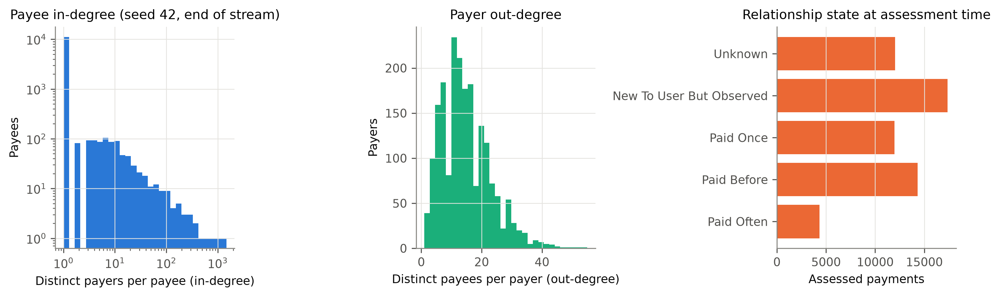

*Figure 14 — Payee in-degree, payer out-degree and relationship state at assessment time (seed 42)* (`figures/fig14_graph_statistics.png`, `.svg`)

- The graph is dominated by one giant component (14,000 of 14,017 nodes in seed 42), because payers share popular merchants; component size is therefore recorded but, by design, never used as a finding.
- 40.7% of payer–payee edges carry repeat payments; payee in-degree is heavy-tailed (median 1, max 1,480).
- The positional finding (collection accounts sharing one victim pool) fired on 18 fraudulent and 0 legitimate payments across the three streams: it is precise but rarely active under this replay design (median mule-account overlap is below its 0.6 gate). Shape findings (restating payee history) are frequent and carry zero weight.

## 18. Chronological Graph Replay

**What was done:** for every payment at time t, in timestamp order: (1) set the application clock to t; (2) read only state recorded before t (payer's earlier rows; ledger, aggregates and graph); (3) assess with the production function `payee_check.check_payee`; (4) record risk, coverage, level, relationship, graph and history evidence and the V2 vector; (5) cross-check the state against an independent shadow model; (6) **only then** record the payment through the production observation path. Afterwards an independent process rebuilds the store from earlier payments only (test 8) and earlier records are compared with the final store (test 9). The only runtime substitution is the injected clock. **Category:** temporal/software validation, separate from the row-level classifier evaluation.

### Table 11 — Chronological graph-replay validation (three streams)

| Test                                          |   Seed 42 checked |   Seed 43 checked |   Seed 44 checked |   Violations (all seeds) | Result   |
|:----------------------------------------------|------------------:|------------------:|------------------:|-------------------------:|:---------|
| 1_first_pair_is_new                           |             60000 |             60000 |             60000 |                        0 | PASS     |
| 2_prior_pair_count_matches_earlier_rows       |             60000 |             60000 |             60000 |                        0 | PASS     |
| 3_distinct_payers_only_prior                  |             60000 |             60000 |             60000 |                        0 | PASS     |
| 4_arrival_window_only_prior                   |             47980 |             46950 |             47704 |                        0 | PASS     |
| 5_component_is_pre_payment                    |             47980 |             46950 |             47704 |                        0 | PASS     |
| 6_position_finding_only_when_gates_hold       |             47980 |             46950 |             47704 |                        0 | PASS     |
| 7_unobserved_payee_graph_unavailable_not_zero |             12020 |             13050 |             12296 |                        0 | PASS     |
| 8_independent_rebuild_prior_only_identical    |                51 |                54 |                60 |                        0 | PASS     |
| 9a_earlier_observations_not_rewritten         |             30000 |             30000 |             30000 |                        0 | PASS     |
| 10_store_contains_only_earlier_payments       |             60000 |             60000 |             60000 |                        0 | PASS     |

Tests 1–7 and 10 are checked online at every assessment against an independent shadow model of earlier payments; 8 by an independent rebuild of the store from earlier payments only; 9a by comparing observation rows written before the stream midpoint with the final store.

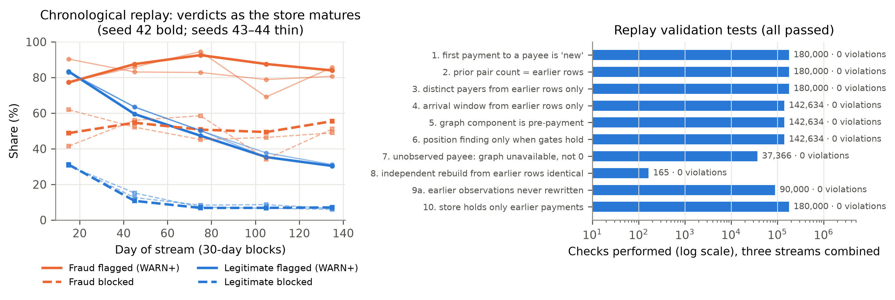

*Figure 15 — Verdicts as the store matures (left) and replay validation checks (right)* (`figures/fig15_replay.png`, `.svg`)

Power check: re-assessing the 165 sampled payments against the *final* store (which contains their future) changes at least one recorded quantity for 165 of them — the pre-payment boundary is material, so the tests above can detect leakage.

### 18.1 Concrete example — before / assessment / after

**Mule-collection payment** — stream 42, `t057636`, 2026-05-25 00:11:11.569000, amount Rs 1,404.77, label: fraud (mule_collection). Re-executed from a fresh store holding only earlier payments; identical to the replay record: **True**.

| | Before the payment | After recording it |
|---|---|---|
| Payer→payee edge | none (first payment) | 1 payment(s), last 2026-05-25T00:11:11 |
| Payee: distinct / repeat payers / payments | 16 / 0 / 16 | 17 / 0 / 17 |
| Payee arrival window | 2026-05-23T08:58:43 → 2026-05-24T18:14:27 | 2026-05-23T08:58:43 → 2026-05-25T00:11:11 |
| Graph view: component / arrival span (days) / shared-payer peak | 13,825 / 1.386 / 16 | 13,825 / 1.634 / 17 |
| Graph findings (shape; positional) | 3 shape; 0 positional | 3 shape; 0 positional |
| Observations in store | 57,636 | 57,637 |

*Assessment (at t, before recording):* relationship state **NEW_TO_USER_BUT_OBSERVED**; families (score; facts): address and qr 0 [address_integrity]; link safety 0 [link_reputation]; payee history 82 [payee_shape]; amount context 0 [amount_absolute]; stated intent 44 [stated_purpose]; message pressure 0 [message_coercion]; relationship 0 [payee_familiarity]; payer behaviour 33 [hour_anomaly, payee_familiarity]; graph 0; Classifier (V2) 15 (p = 0.0915). Corroborating facts: hour_anomaly, payee_familiarity, payee_shape, stated_purpose (bonus 14). **Ten-family result with V2: R = 99, coverage 100, level FULL, verdict BLOCK.** Findings: graph_payee_shape, investment_to_stranger, message_authority, message_fear, message_urgency, message_weak_cues_only, ml_behavioural_risk, mule_pattern, payer_behaviour, streams_agree.

**Repeat payment to a known payee** — stream 42, `t024996`, 2026-03-04 10:09:11, amount Rs 2,223.89, label: legitimate. Re-executed from a fresh store holding only earlier payments; identical to the replay record: **True**.

| | Before the payment | After recording it |
|---|---|---|
| Payer→payee edge | 5 payments since 2026-01-09 | 6 payment(s), last 2026-03-04T10:09:11 |
| Payee: distinct / repeat payers / payments | 1 / 1 / 5 | 1 / 1 / 6 |
| Payee arrival window | 2026-01-09T14:12:38 → 2026-01-09T14:12:38 | 2026-01-09T14:12:38 → 2026-01-09T14:12:38 |
| Graph view: component / arrival span (days) / shared-payer peak | 9,571 / 0.000 / None | 9,571 / 0.000 / None |
| Graph findings (shape; positional) | 0 shape; 0 positional | 0 shape; 0 positional |
| Observations in store | 24,996 | 24,997 |

*Assessment (at t, before recording):* relationship state **PAID_OFTEN**; families (score; facts): address and qr 0 [address_integrity]; link safety 0 [link_reputation]; payee history 0; amount context 0 [amount_absolute]; stated intent unavailable; message pressure unavailable; relationship 0 [payee_familiarity]; payer behaviour 0; graph 0; Classifier (V2) 0 (p = 0.0000). Corroborating facts: none (bonus 0). **Ten-family result with V2: R = 0, coverage 96, level FULL, verdict APPROVE.** Findings: mostly_digits.

The first example shows a new payer–payee relationship being detected (no edge before; one edge after) while the payee's history already shows a compressed arrival of one-time payers, which the payee-history family scores; the second shows a repeat relationship (edge count 5 → 6) assessed as low risk. In both, the store changes only after the assessment.

## 19. Software Test Validation

### Table 10 — Software test validation (pytest, project machine)

| Category (module subject)                       |   Modules |   Tests |   Passed |   Failed |   Skipped |   Time (s) | Modules list                                                                                                                                                |
|:------------------------------------------------|----------:|--------:|---------:|---------:|----------:|-----------:|:------------------------------------------------------------------------------------------------------------------------------------------------------------|
| Graph behaviour                                 |         4 |      53 |       53 |        0 |         0 |       13.2 | test_graph_cache, test_graph_semantics, test_fraud_graph, test_graph_detector                                                                               |
| Risk aggregation, corroboration and verdicts    |         7 |     142 |      142 |        0 |         0 |       16.5 | test_evidence_model, test_fact_corroboration, test_payee_check, test_score_granularity, test_verdict_vocabulary, test_risk_rules, test_open_findings        |
| Missing / unavailable evidence                  |         2 |      29 |       29 |        0 |         0 |        5.7 | test_evidence_availability, test_entity_status                                                                                                              |
| Model, thresholding and evaluation pipeline     |         5 |      72 |       72 |        0 |         0 |       22.5 | test_ml_family, test_model_pipeline, test_model_portability, test_evaluation_pipeline, test_evaluation_v2                                                   |
| Feature construction (V2 dataset and serving)   |         5 |     115 |      115 |        0 |         0 |       22.5 | test_features_v2, test_dataset_v2, test_serving_velocity, test_amount_context, test_upi_amount_limits                                                       |
| Chronological ordering and time handling        |         4 |      46 |       46 |        0 |         0 |       26   | test_cross_source_and_timezone, test_statement_time, test_history_rebuild, test_payee_history                                                               |
| JSON serialisation                              |         1 |      16 |       16 |        0 |         0 |        7.7 | test_predict_serialization                                                                                                                                  |
| API behaviour and security boundary             |         3 |      97 |       97 |        0 |         0 |       18.5 | test_api_contract, test_api_boundary_security, test_chat                                                                                                    |
| Contextual families (message, link, address/QR) |         3 |      87 |       87 |        0 |         0 |        8.2 | test_coercion, test_scam_link, test_upi_identity                                                                                                            |
| Statement ingestion and parsing                 |         6 |     153 |      153 |        0 |         0 |       24.4 | test_bank_statement_providers, test_statement_ingestion, test_statement_parser, test_statement_pipeline, test_parser_regressions, test_real_bank_statements |
| Regression and miscellaneous edge cases         |         3 |      10 |       10 |        0 |         0 |        4.8 | test_audit_regressions, test_device_risk, test_geo_risk                                                                                                     |
| Total                                           |        43 |     820 |      820 |        0 |         0 |      170.1 |                                                                                                                                                             |

Run on the project machine (Python 3.10.12, Linux 6.8 x86_64) with `python -m pytest tests/<module>.py -q --tb=no`, one module at a time, with a throwaway JWT_SECRET; conftest.py isolates every run in a temporary database. Six pytest warnings, no errors. Time = sum of pytest-reported module times. These are implementation-correctness results, NOT fraud-detection accuracy.

**Result:** 820 tests collected and 820 passed, 0 failed, 0 skipped (6 warnings) in 170.1 s of pytest time. Per-module results: `software_tests/pytest_summary_by_file.csv`; keyword coverage of concerns across modules (thresholds, missing evidence, graph, verdicts, corroboration, strict time boundary, JSON): `software_tests/test_keyword_coverage.csv`. There is no front-end (TypeScript) test suite in the repository. **These are implementation-correctness results and say nothing about fraud-detection accuracy.**

## 20. Leakage Audit

Full audit with evidence: `leakage_audit/LEAKAGE_AUDIT.md`. **Summary: 16 PASS · 0 FAIL · 2 NOT APPLICABLE.**

| # | Check | Status |
|---|---|---|
| 1 | No test labels used during training | PASS |
| 2 | No test labels used for threshold selection | PASS |
| 3 | No test-set metric used for model selection | PASS |
| 4 | No future graph information used | PASS |
| 5 | No post-payment information used at pre-payment decision time | PASS |
| 6 | No future payer behaviour used | PASS |
| 7 | No future payee history used | PASS |
| 8 | No test-derived preprocessing | PASS |
| 9 | No test-derived imputation | NOT APPLICABLE |
| 10 | No test-derived scaling | NOT APPLICABLE |
| 11 | No test-derived calibration | PASS |
| 12 | No message-template leakage between train and test | PASS |
| 13 | No duplicate rows across train/validation/test | PASS |
| 14 | No identity leakage | PASS |
| 15 | No target leakage | PASS |
| 16 | Current transaction not inserted before its own chronological assessment | PASS |
| 17 | No hidden fraud labels used by evidence modules | PASS |
| 18 | No outcome information used in the pre-payment path | PASS |

No serious leakage was found, so no result was withdrawn. Two passes carry disclosed caveats: message templates are shared between train and test (effect measured and negligible, Section 14), and the row-level split is random, so a payer's rows can appear in both train and test (identity is not a feature, but generalisation to unseen payers is not measured by the row-level experiments).

## 21. Reproducibility

- Experiments: Python 3.11.15, numpy 2.2.6, pandas 2.3.3, scikit-learn 1.7.2, scipy 1.15.3, joblib 1.6.0, matplotlib 3.11.2, shap 0.49.1 (Linux-6.18.44-fc-v37-x86_64-with-glibc2.39).
- Frozen V2 model: scikit-learn 1.7.2 (the pickle loads under scikit-learn 1.7.2 with no InconsistentVersionWarning); the remaining build-environment versions are not recorded in models/metrics_v2.json. Software tests: project machine: Python 3.10.12, pytest 9.1.1, numpy 2.2.6, pandas 2.3.3, scikit-learn 1.7.2.
- Seeds: {'frozen_v2_corpus_and_split': 42, 'ten_seed_and_ablation': [42, 43, 44, 45, 46, 47, 48, 49, 50, 51], 'replay_streams': [42, 43, 44], 'hgb_random_state': '= seed', 'split_random_state': '= seed', 'permutation_importance': 42, 'shap_sample': 42}.
- Git HEAD of the evaluated snapshot: `9022a9feb65effa32779207e32458c0d37e9bb61`; SHA-256 of models, generators, corpus, experiment scripts and every result file: `reproducibility/reproducibility_manifest.json`. Human-readable manifest with the exact commands: `reproducibility/REPRODUCIBILITY_MANIFEST.md`.
- Replay-only runtime substitutions (none changes a prediction): application clock set to the replay time; larger regex cache; single OpenMP thread.

## 22. Limitations and Interpretation

- **Synthetic data only.** All corpora come from simulators whose scenarios, overlaps and channel probabilities were specified by the project; the evaluation cannot reveal where those assumptions are wrong. No real UPI, PSP, bank or NPCI data were used.
- **Simulator-generated V2 channels.** Relationship, graph, message, link and intent features in the row-level corpus are drawn conditional on the scenario; the ablation measures how much of that designed signal the model recovers.
- **Message pool.** 1,022 English templates written for the project; the template-disjoint control removes exact-template reuse, not the single authorial style.
- **Prevalence and calibration.** Precision, PR-AUC and calibration were measured at ~1.2% prevalence; they change at other prevalences and under drift.
- **Transfer between simulators.** The frozen V2 model's operating point does not carry over from the row-level corpus to the replay streams (Section 15).
- **End-to-end system.** Rule weights and verdict bands are fixed design parameters, never fitted to labelled data; the resulting intervention rate on legitimate payments is high, and payee evidence depends on how long the store has been observing (cold start).
- **Graph.** Explicit analytics only; its positional finding rarely fires on this replay design; graph features grow with store age.
- **Replay scale.** Three streams of 150 days, 3–4 mule rings each.
- **No deployment claims.** The prototype is advisory, not deployed, not integrated with any bank, PSP or NPCI system; latency was not benchmarked (NOT AVAILABLE FROM CURRENT IMPLEMENTATION: no latency benchmark exists in the repository).

## 23. Complete Results Summary

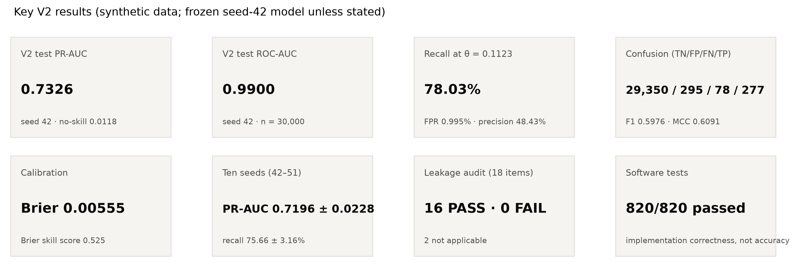

*Figure 0 — Key V2 results overview (every value read from the result files)* (`figures/fig00_key_results.png`, `.svg`)

| Result | Split / data | Value |
|---|---|---|
| V2 test PR-AUC / ROC-AUC (existing = reproduced) | seed 42 test, n = 30,000 | 0.7326 / 0.9900 |
| Recall / FPR / precision / F1 at θ = 0.1123 | seed 42 test | 0.7803 / 0.00995 / 0.4843 / 0.5976 |
| Confusion TN / FP / FN / TP | seed 42 test | 29,350 / 295 / 78 / 277 |
| MCC / balanced accuracy / specificity | seed 42 test | 0.6091 / 0.8852 / 0.9900 |
| Brier / BSS / ECE (10 bins) | seed 42 test | 0.00555 / 0.5251 / 0.0017 |
| Scenario recall SE / MC / AT / CT | seed 42 test | 65.93% / 85.00% / 94.52% / 100.00% |
| Ten-seed PR-AUC | seeds 42–51 test | 0.7196 ± 0.0228 (min 0.6829, max 0.7693) |
| Ten-seed recall at ~1% FPR / realised FPR | seeds 42–51 test | 75.66 ± 3.16% / 0.991 ± 0.078% |
| Largest ablation losses (PR-AUC) | seeds 42–51 | payer behaviour -16.03 ± 2.29 pp; relational -12.35 ± 1.59 pp; graph -8.41 ± 0.90 pp |
| Template-disjoint control, full V2 | seeds 42–51 | Δ -0.42 ± 0.71 pp PR-AUC |
| Ten-family risk PR-AUC / ROC-AUC | replay, last 25%, 3 streams | 0.1198 ± 0.0170 / 0.8504 ± 0.0158 |
| Legitimate APPROVE / BLOCK | replay, last 25% | 68.9 ± 0.6% / 6.8 ± 0.6% |
| Fraud BLOCK recall | replay, last 25% | 51.0 ± 6.4% |
| Replay validation tests | 3 streams | 10/10 pass; e.g. 180,000 pre-payment boundary checks, 0 violations |
| Software tests | project machine | 820/820 passed |
| Leakage audit | all experiments | 16 PASS, 0 FAIL, 2 N/A |

**Not available from the current implementation:** latency/throughput benchmarks; any evaluation on real UPI data; per-scenario precision (false positives belong to no scenario).

